# APMG — Sample Demonstration Clips

Qualitative inference demos of **APMG (ours)**, a video violence-detection model, on public benchmark clips, next to six published comparators. Only rendered example outputs are shared here; the code, model details and training setup are not part of this repository.

---

## 1. Introduction

This repository contains **49 short clips** (MP4 + GIF) from the held-out **test** splits of five public benchmarks, plus one real-time demo. **Batch 1** holds four rule-selected clips per dataset (best and worst for each class), **Batch 2** best and bad clips under specific conditions (camera motion, brightness, temporal sampling, comparison with the strongest comparators), and Section 4 a live-stream run.

**These are pre-rendered visualization clips, not the raw benchmark datasets.** Each `.mp4` is a side-by-side panel:

- **Left** — the clip with APMG's decision: label and confidence bar, border **red = predicted violent**, **green = predicted non-violent**.
- **Right** — P(violence) over time for **APMG (ours, solid)** and six comparators (dashed): Kang et al., DualCascade-TSF, KianNet, SE-MobileNet, SepConvLSTM, VGG19-LSTM. At every frame each model re-samples its input from the frames seen so far, so the last point equals the model's whole-clip test prediction.

**How the clips were chosen** (fixed rules, no hand-picking). APMG was trained with three seeds (SURV: five cross-validation folds). *best* = correct for every seed with the highest probability of the true class; *bad* = wrong for the majority of seeds with the most confident error; *hardest* = the least confident correct clip when a dataset has no error of that kind. The videos show the **seed-42** model (SURV: the fold model that had the clip in its test fold, never one trained on it), so a bad case can be correct for seed 42 — the table gives both. ✗ = wrong decision. Long UBI clips are shown uniformly sampled to 360 frames. Note: two comparator curves use checkpoints re-trained after an interruption, whose decisions differ from the reported test predictions on some clips: DualCascade-TSF on RLVS (2/300) and SE-MobileNet on RWF-2000 (99/400); all other curves reproduce the test predictions (|ΔP| < 0.01).

---

## 2. Batch 1 — best and bad cases on all five datasets

### Hockey Fight

| Case | Clip | Truth | APMG 3-seed ptrue (seeds correct) | APMG (ours) | Kang et al. | DualCascade-TSF | KianNet | SE-MobileNet | SepConvLSTM | VGG19-LSTM |
|:--|:--|:--|--:|--:|--:|--:|--:|--:|--:|--:|
| best violent | [`fi88_xvid.avi`](best_bad_cases/hockey/class_best_true_violent_fi88_xvid.mp4) | Violence | 0.98 (3/3) | **0.98** | 1.00 | 1.00 | 0.98 | 0.99 | 1.00 | 1.00 |
| best non-violent | [`no240_xvid.avi`](best_bad_cases/hockey/class_best_true_non_violent_no240_xvid.mp4) | Normal | 0.99 (3/3) | **0.01** | 0.00 | 0.00 | 0.02 | 0.58 ✗ | 0.00 | 0.01 |
| hardest violent (no FN) | [`fi222_xvid.avi`](best_bad_cases/hockey/class_hardest_true_violent_fi222_xvid.mp4) | Violence | 0.80 (3/3) | **0.56** | 0.17 ✗ | 0.33 ✗ | 0.03 ✗ | 0.97 | 0.98 | 0.09 ✗ |
| bad FP (false alarm) | [`no92_xvid.avi`](best_bad_cases/hockey/class_bad_true_non_violent_no92_xvid.mp4) | Normal | 0.09 (0/3) | **0.94 ✗** | 0.89 ✗ | 0.24 | 0.98 ✗ | 0.85 ✗ | 0.28 | 0.96 ✗ |

<table>
<tr>
<td align="center" width="50%">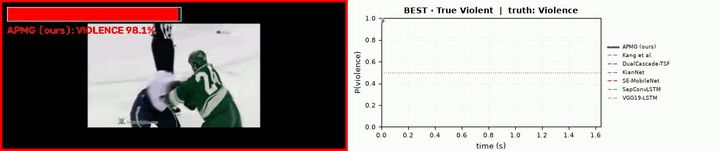 <b>best violent</b> · <code>fi88_xvid.avi</code> (truth: Violence)</td>
<td align="center" width="50%">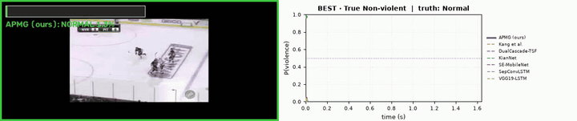 <b>best non-violent</b> · <code>no240_xvid.avi</code> (truth: Normal)</td>
</tr>
<tr>
<td align="center" width="50%">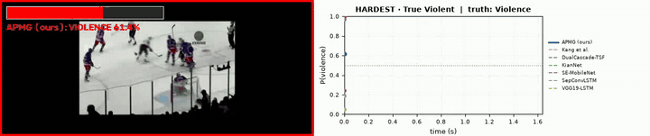 <b>hardest violent (no FN)</b> · <code>fi222_xvid.avi</code> (truth: Violence)</td>
<td align="center" width="50%">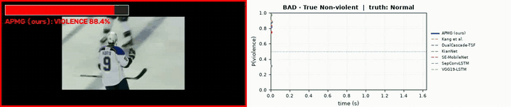 <b>bad FP (false alarm)</b> · <code>no92_xvid.avi</code> (truth: Normal)</td>
</tr>
</table>

### Surveillance Camera Fight (SURV)

| Case | Clip | Truth | APMG 3-seed ptrue (seeds correct) | APMG (ours) | Kang et al. | DualCascade-TSF | KianNet | SE-MobileNet | SepConvLSTM | VGG19-LSTM |
|:--|:--|:--|--:|--:|--:|--:|--:|--:|--:|--:|
| best violent | [`fi040.mp4`](best_bad_cases/surv/class_best_true_violent_fi040.mp4) | Violence | 0.99 (CV fold) | **0.99** | 0.66 | 0.87 | 0.99 | 1.00 | 0.85 | 0.64 |
| best non-violent | [`nofi073.mp4`](best_bad_cases/surv/class_best_true_non_violent_nofi073.mp4) | Normal | 1.00 (CV fold) | **0.00** | 0.01 | 0.03 | 0.02 | 0.94 ✗ | 0.04 | 0.04 |
| bad FN (missed violence) | [`fi092.mp4`](best_bad_cases/surv/class_bad_true_violent_fi092.mp4) | Violence | 0.01 (CV fold) | **0.01 ✗** | 0.02 ✗ | 0.09 ✗ | 0.11 ✗ | 1.00 | 0.34 ✗ | 0.52 |
| bad FP (false alarm) | [`nofi044.mp4`](best_bad_cases/surv/class_bad_true_non_violent_nofi044.mp4) | Normal | 0.01 (CV fold) | **0.99 ✗** | 0.70 ✗ | 0.56 ✗ | 0.99 ✗ | 1.00 ✗ | 0.26 | 0.72 ✗ |

<table>
<tr>
<td align="center" width="50%">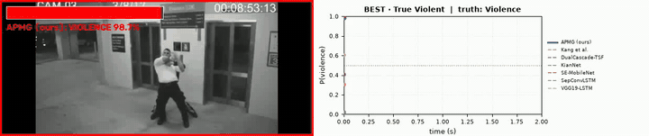 <b>best violent</b> · <code>fi040.mp4</code> (truth: Violence)</td>
<td align="center" width="50%">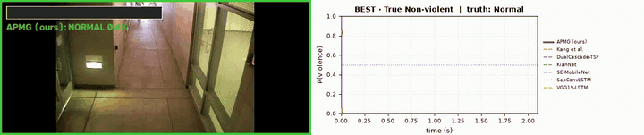 <b>best non-violent</b> · <code>nofi073.mp4</code> (truth: Normal)</td>
</tr>
<tr>
<td align="center" width="50%">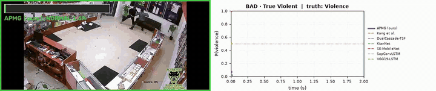 <b>bad FN (missed violence)</b> · <code>fi092.mp4</code> (truth: Violence)</td>
<td align="center" width="50%">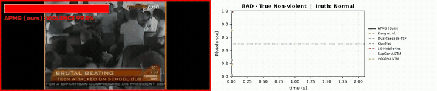 <b>bad FP (false alarm)</b> · <code>nofi044.mp4</code> (truth: Normal)</td>
</tr>
</table>

### RLVS

| Case | Clip | Truth | APMG 3-seed ptrue (seeds correct) | APMG (ours) | Kang et al. | DualCascade-TSF | KianNet | SE-MobileNet | SepConvLSTM | VGG19-LSTM |
|:--|:--|:--|--:|--:|--:|--:|--:|--:|--:|--:|
| best violent | [`V_293.mp4`](best_bad_cases/rlvs/class_best_true_violent_V_293.mp4) | Violence | 0.98 (3/3) | **0.98** | 1.00 | 1.00 | 0.97 | 0.42 ✗ | 0.99 | 1.00 |
| best non-violent | [`NV_517.mp4`](best_bad_cases/rlvs/class_best_true_non_violent_NV_517.mp4) | Normal | 0.98 (3/3) | **0.02** | 0.00 | 0.00 | 0.03 | 0.18 | 0.00 | 0.00 |
| bad FN (missed violence) | [`V_669.mp4`](best_bad_cases/rlvs/class_bad_true_violent_V_669.mp4) | Violence | 0.21 (1/3) | **0.04 ✗** | 0.23 ✗ | 0.69 | 0.82 | 0.02 ✗ | 0.17 ✗ | 0.01 ✗ |
| bad FP (false alarm) | [`NV_576.mp4`](best_bad_cases/rlvs/class_bad_true_non_violent_NV_576.mp4) | Normal | 0.11 (0/3) | **0.92 ✗** | 0.02 | 0.09 | 0.51 ✗ | 0.09 | 0.06 | 0.09 |

<table>
<tr>
<td align="center" width="50%">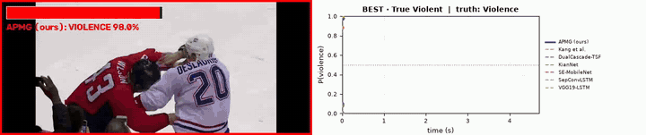 <b>best violent</b> · <code>V_293.mp4</code> (truth: Violence)</td>
<td align="center" width="50%">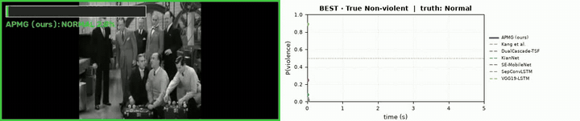 <b>best non-violent</b> · <code>NV_517.mp4</code> (truth: Normal)</td>
</tr>
<tr>
<td align="center" width="50%">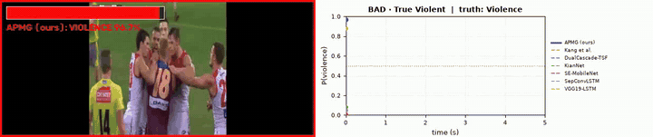 <b>bad FN (missed violence)</b> · <code>V_669.mp4</code> (truth: Violence)</td>
<td align="center" width="50%">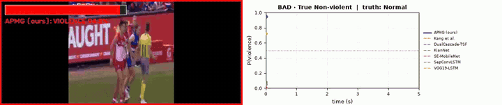 <b>bad FP (false alarm)</b> · <code>NV_576.mp4</code> (truth: Normal)</td>
</tr>
</table>

### RWF-2000

| Case | Clip | Truth | APMG 3-seed ptrue (seeds correct) | APMG (ours) | Kang et al. | DualCascade-TSF | KianNet | SE-MobileNet | SepConvLSTM | VGG19-LSTM |
|:--|:--|:--|--:|--:|--:|--:|--:|--:|--:|--:|
| best violent | [`7gLKFV5voOg_0.avi`](best_bad_cases/rwfreal/class_best_true_violent_7gLKFV5voOg_0.mp4) | Violence | 0.97 (3/3) | **0.95** | 0.97 | 0.51 | 0.98 | 0.19 ✗ | 0.59 | 0.66 |
| best non-violent | [`I9OYGpUd_0.avi`](best_bad_cases/rwfreal/class_best_true_non_violent_I9OYGpUd_0.mp4) | Normal | 0.97 (3/3) | **0.02** | 0.00 | 0.02 | 0.02 | 0.10 | 0.02 | 0.02 |
| bad FN (missed violence) | [`I-QiUMPTWNE_8.avi`](best_bad_cases/rwfreal/class_bad_true_violent_I-QiUMPTWNE_8.mp4) | Violence | 0.04 (0/3) | **0.03 ✗** | 0.01 ✗ | 0.51 | 0.98 | 0.09 ✗ | 0.54 | 0.68 |
| bad FP (false alarm) | [`Wq0BuA8GM84_0.avi`](best_bad_cases/rwfreal/class_bad_true_non_violent_Wq0BuA8GM84_0.mp4) | Normal | 0.04 (0/3) | **0.93 ✗** | 0.83 ✗ | 0.28 | 0.03 | 0.86 ✗ | 0.24 | 0.66 ✗ |

<table>
<tr>
<td align="center" width="50%">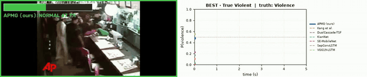 <b>best violent</b> · <code>7gLKFV5voOg_0.avi</code> (truth: Violence)</td>
<td align="center" width="50%">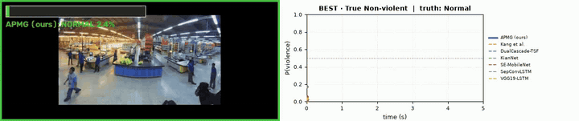 <b>best non-violent</b> · <code>I9OYGpUd_0.avi</code> (truth: Normal)</td>
</tr>
<tr>
<td align="center" width="50%">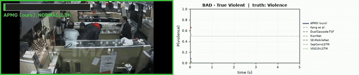 <b>bad FN (missed violence)</b> · <code>I-QiUMPTWNE_8.avi</code> (truth: Violence)</td>
<td align="center" width="50%">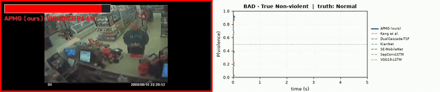 <b>bad FP (false alarm)</b> · <code>Wq0BuA8GM84_0.avi</code> (truth: Normal)</td>
</tr>
</table>

### UBI-Fights

| Case | Clip | Truth | APMG 3-seed ptrue (seeds correct) | APMG (ours) | Kang et al. | DualCascade-TSF | KianNet | SE-MobileNet | SepConvLSTM | VGG19-LSTM |
|:--|:--|:--|--:|--:|--:|--:|--:|--:|--:|--:|
| best violent | [`F_107_1_2_0_0.mp4`](best_bad_cases/ubi/class_best_true_violent_F_107_1_2_0_0.mp4) | Violence | 0.99 (3/3) | **0.99** | 1.00 | 1.00 | 0.99 | 1.00 | 0.98 | 1.00 |
| best non-violent | [`N_758_1_1_1_0.mp4`](best_bad_cases/ubi/class_best_true_non_violent_N_758_1_1_1_0.mp4) | Normal | 0.94 (3/3) | **0.03** | 0.66 ✗ | 0.74 ✗ | 0.36 | 0.38 | 0.37 | 0.15 |
| bad FN (missed violence) | [`F_156_1_0_1_0.mp4`](best_bad_cases/ubi/class_bad_true_violent_F_156_1_0_1_0.mp4) | Violence | 0.07 (0/3) | **0.04 ✗** | 0.60 | 0.00 ✗ | 0.10 ✗ | 0.02 ✗ | 0.03 ✗ | 0.04 ✗ |
| bad FP (false alarm) | [`N_612_1_0_1_0.mp4`](best_bad_cases/ubi/class_bad_true_non_violent_N_612_1_0_1_0.mp4) | Normal | 0.01 (0/3) | **0.98 ✗** | 0.97 ✗ | 0.97 ✗ | 0.99 ✗ | 0.99 ✗ | 0.96 ✗ | 0.98 ✗ |

<table>
<tr>
<td align="center" width="50%">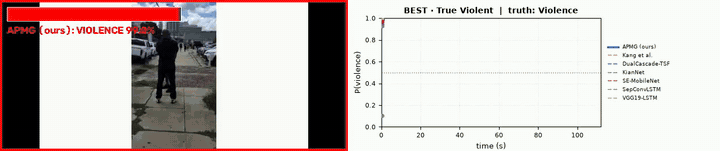 <b>best violent</b> · <code>F_107_1_2_0_0.mp4</code> (truth: Violence)</td>
<td align="center" width="50%">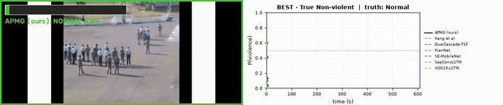 <b>best non-violent</b> · <code>N_758_1_1_1_0.mp4</code> (truth: Normal)</td>
</tr>
<tr>
<td align="center" width="50%">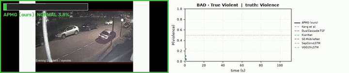 <b>bad FN (missed violence)</b> · <code>F_156_1_0_1_0.mp4</code> (truth: Violence)</td>
<td align="center" width="50%">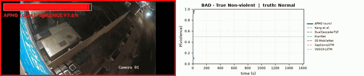 <b>bad FP (false alarm)</b> · <code>N_612_1_0_1_0.mp4</code> (truth: Normal)</td>
</tr>
</table>

---

## 3. Batch 2 — best and bad cases by condition

Conditions: camera ego-motion (lowest / highest tercile of the clip's global-motion score), brightness (darkest / brightest tercile), test-time frame sampling (*robust* / *fragile*: stable / unstable when the frames given to the model change), and APMG vs. Kang et al., DualCascade-TSF and KianNet (*APMG wins* / *APMG loses*).

### Camera ego-motion

| Dataset | Case | Clip | Truth | APMG 3-seed ptrue (seeds correct) | APMG (ours) | Kang et al. | DualCascade-TSF | KianNet | SE-MobileNet | SepConvLSTM | VGG19-LSTM |
|:--|:--|:--|:--|--:|--:|--:|--:|--:|--:|--:|--:|
| Hockey Fight | BEST · High camera motion | [`no181_xvid.avi`](condition_cases/hockey/motion_best_high_camera_motion_no181_xvid.mp4) | Normal | 0.98 (3/3) | **0.02** | 0.00 | 0.00 | 0.03 | 0.21 | 0.00 | 0.02 |
| Surveillance Camera Fight | BEST · Low camera motion | [`nofi086.mp4`](condition_cases/surv/motion_best_low_camera_motion_nofi086.mp4) | Normal | 0.99 (CV fold) | **0.01** | 0.00 | 0.06 | 0.03 | 0.89 ✗ | 0.48 | 0.04 |
| RLVS | BEST · Low camera motion | [`V_434.mp4`](condition_cases/rlvs/motion_best_low_camera_motion_V_434.mp4) | Violence | 0.98 (3/3) | **0.98** | 1.00 | 1.00 | 0.98 | 0.17 ✗ | 0.99 | 1.00 |
| RLVS | HARDEST · Low camera motion | [`NV_638.mp4`](condition_cases/rlvs/motion_hardest_low_camera_motion_NV_638.mp4) | Normal | 0.83 (3/3) | **0.02** | 0.01 | 0.01 | 0.04 | 0.75 ✗ | 0.01 | 0.03 |
| RLVS | BEST · High camera motion | [`V_171.mp4`](condition_cases/rlvs/motion_best_high_camera_motion_V_171.mp4) | Violence | 0.98 (3/3) | **0.98** | 0.98 | 1.00 | 0.98 | 0.67 | 1.00 | 1.00 |
| RLVS | BAD · High camera motion | [`NV_558.mp4`](condition_cases/rlvs/motion_bad_high_camera_motion_NV_558.mp4) | Normal | 0.31 (1/3) | **0.91 ✗** | 0.65 ✗ | 0.03 | 0.06 | 0.71 ✗ | 0.68 ✗ | 0.72 ✗ |
| RWF-2000 | BAD · Low camera motion | [`XM0NI7ZmwWM_3.avi`](condition_cases/rwfreal/motion_bad_low_camera_motion_XM0NI7ZmwWM_3.mp4) | Violence | 0.05 (0/3) | **0.08 ✗** | 0.01 ✗ | 0.88 | 0.03 ✗ | 0.00 ✗ | 0.28 ✗ | 0.58 |
| RWF-2000 | BEST · High camera motion | [`g6jdqkcdgqk_5.avi`](condition_cases/rwfreal/motion_best_high_camera_motion_g6jdqkcdgqk_5.mp4) | Violence | 0.97 (3/3) | **0.95** | 0.62 | 0.98 | 0.93 | 0.76 | 0.67 | 0.67 |
| RWF-2000 | BAD · High camera motion | [`RIXaF_TkLlU_2.avi`](condition_cases/rwfreal/motion_bad_high_camera_motion_RIXaF_TkLlU_2.mp4) | Normal | 0.04 (0/3) | **0.93 ✗** | 0.23 | 0.11 | 0.98 ✗ | 0.73 ✗ | 0.87 ✗ | 0.68 ✗ |
| UBI-Fights | BEST · Low camera motion | [`F_89_1_0_0_0.mp4`](condition_cases/ubi/motion_best_low_camera_motion_F_89_1_0_0_0.mp4) | Violence | 0.98 (3/3) | **0.96** | 0.99 | 0.96 | 0.79 | 0.97 | 0.98 | 0.99 |
| UBI-Fights | BAD · High camera motion | [`N_253_0_0_1_0.mp4`](condition_cases/ubi/motion_bad_high_camera_motion_N_253_0_0_1_0.mp4) | Normal | 0.37 (1/3) | **0.79 ✗** | 0.91 ✗ | 0.85 ✗ | 0.15 | 0.03 | 0.52 ✗ | 1.00 ✗ |

GIFs

<table>
<tr>
<td align="center" width="50%">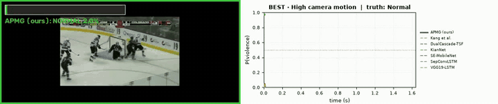 <b>BEST · High camera motion</b> · <code>no181_xvid.avi</code> (truth: Normal)</td>
<td align="center" width="50%">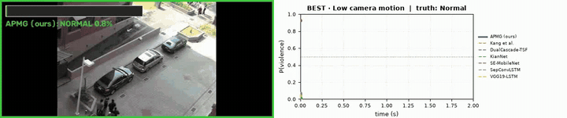 <b>BEST · Low camera motion</b> · <code>nofi086.mp4</code> (truth: Normal)</td>
</tr>
<tr>
<td align="center" width="50%">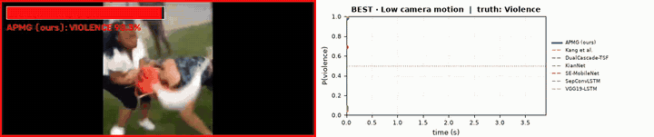 <b>BEST · Low camera motion</b> · <code>V_434.mp4</code> (truth: Violence)</td>
<td align="center" width="50%">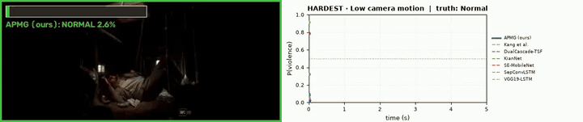 <b>HARDEST · Low camera motion</b> · <code>NV_638.mp4</code> (truth: Normal)</td>
</tr>
<tr>
<td align="center" width="50%">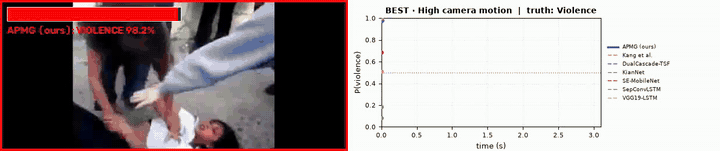 <b>BEST · High camera motion</b> · <code>V_171.mp4</code> (truth: Violence)</td>
<td align="center" width="50%">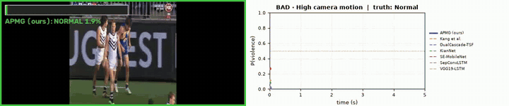 <b>BAD · High camera motion</b> · <code>NV_558.mp4</code> (truth: Normal)</td>
</tr>
<tr>
<td align="center" width="50%">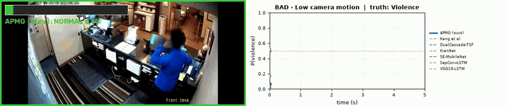 <b>BAD · Low camera motion</b> · <code>XM0NI7ZmwWM_3.avi</code> (truth: Violence)</td>
<td align="center" width="50%">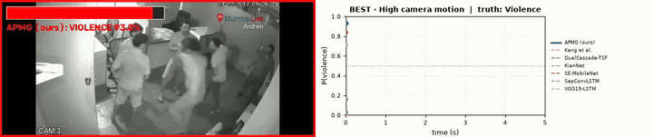 <b>BEST · High camera motion</b> · <code>g6jdqkcdgqk_5.avi</code> (truth: Violence)</td>
</tr>
<tr>
<td align="center" width="50%">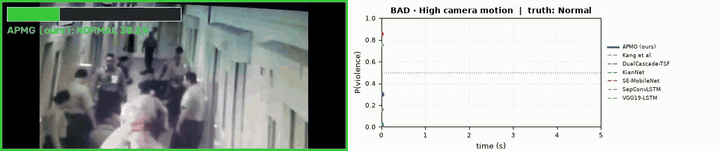 <b>BAD · High camera motion</b> · <code>RIXaF_TkLlU_2.avi</code> (truth: Normal)</td>
<td align="center" width="50%">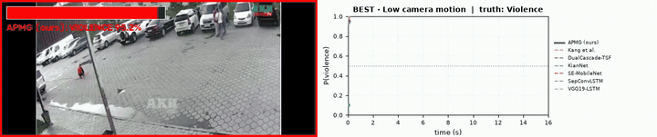 <b>BEST · Low camera motion</b> · <code>F_89_1_0_0_0.mp4</code> (truth: Violence)</td>
</tr>
<tr>
<td align="center" width="50%">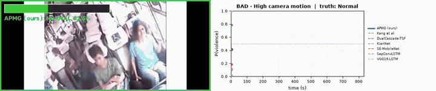 <b>BAD · High camera motion</b> · <code>N_253_0_0_1_0.mp4</code> (truth: Normal)</td>
</tr>
</table>

### Brightness

| Dataset | Case | Clip | Truth | APMG 3-seed ptrue (seeds correct) | APMG (ours) | Kang et al. | DualCascade-TSF | KianNet | SE-MobileNet | SepConvLSTM | VGG19-LSTM |
|:--|:--|:--|:--|--:|--:|--:|--:|--:|--:|--:|--:|
| Hockey Fight | BEST · Dark (lowest-brightness tercile) | [`no69_xvid.avi`](condition_cases/hockey/brightness_best_dark__lowest_brightness_tercile_no69_xvid.mp4) | Normal | 0.99 (3/3) | **0.01** | 0.05 | 0.00 | 0.02 | 0.04 | 0.00 | 0.03 |
| Hockey Fight | BAD · Dark (lowest-brightness tercile) | [`no269_xvid.avi`](condition_cases/hockey/brightness_bad_dark__lowest_brightness_tercile_no269_xvid.mp4) | Normal | 0.32 (1/3) | **0.10** | 0.61 ✗ | 0.96 ✗ | 0.97 ✗ | 0.82 ✗ | 0.99 ✗ | 0.91 ✗ |
| Surveillance Camera Fight | BEST · Dark (lowest-brightness tercile) | [`fi139.mp4`](condition_cases/surv/brightness_best_dark__lowest_brightness_tercile_fi139.mp4) | Violence | 0.99 (CV fold) | **0.99** | 0.74 | 0.87 | 0.99 | 0.97 | 0.07 ✗ | 0.64 |
| Surveillance Camera Fight | BEST · Bright (highest-brightness tercile) | [`nofi067.mp4`](condition_cases/surv/brightness_best_bright__highest_brightness_tercile_nofi067.mp4) | Normal | 0.99 (CV fold) | **0.01** | 0.01 | 0.08 | 0.02 | 0.79 ✗ | 0.17 | 0.05 |
| RLVS | HARDEST · Bright (highest-brightness tercile) | [`NV_98.mp4`](condition_cases/rlvs/brightness_hardest_bright__highest_brightness_tercile_NV_98.mp4) | Normal | 0.44 (2/3) | **0.37** | 0.15 | 0.16 | 0.06 | 0.34 | 0.61 ✗ | 0.00 |
| RWF-2000 | BEST · Dark (lowest-brightness tercile) | [`Yma07mlW_0.avi`](condition_cases/rwfreal/brightness_best_dark__lowest_brightness_tercile_Yma07mlW_0.mp4) | Normal | 0.97 (3/3) | **0.02** | 0.01 | 0.04 | 0.03 | 0.20 | 0.25 | 0.01 |
| RWF-2000 | BEST · Bright (highest-brightness tercile) | [`fGyFpyjd_0.avi`](condition_cases/rwfreal/brightness_best_bright__highest_brightness_tercile_fGyFpyjd_0.mp4) | Normal | 0.97 (3/3) | **0.02** | 0.01 | 0.00 | 0.02 | 0.00 | 0.09 | 0.23 |
| UBI-Fights | BEST · Dark (lowest-brightness tercile) | [`F_120_1_0_0_0.mp4`](condition_cases/ubi/brightness_best_dark__lowest_brightness_tercile_F_120_1_0_0_0.mp4) | Violence | 0.99 (3/3) | **0.99** | 0.94 | 0.99 | 0.99 | 1.00 | 1.00 | 1.00 |
| UBI-Fights | BAD · Bright (highest-brightness tercile) | [`F_151_0_0_1_0.mp4`](condition_cases/ubi/brightness_bad_bright__highest_brightness_tercile_F_151_0_0_1_0.mp4) | Violence | 0.08 (0/3) | **0.08 ✗** | 0.00 ✗ | 0.00 ✗ | 0.17 ✗ | 0.09 ✗ | 0.02 ✗ | 0.01 ✗ |

GIFs

<table>
<tr>
<td align="center" width="50%">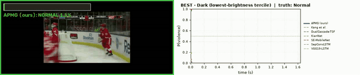 <b>BEST · Dark (lowest-brightness tercile)</b> · <code>no69_xvid.avi</code> (truth: Normal)</td>
<td align="center" width="50%">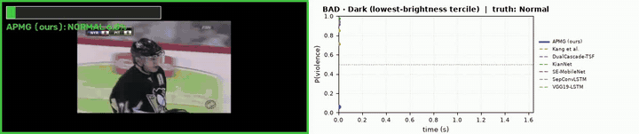 <b>BAD · Dark (lowest-brightness tercile)</b> · <code>no269_xvid.avi</code> (truth: Normal)</td>
</tr>
<tr>
<td align="center" width="50%">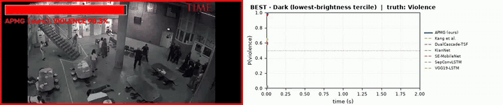 <b>BEST · Dark (lowest-brightness tercile)</b> · <code>fi139.mp4</code> (truth: Violence)</td>
<td align="center" width="50%">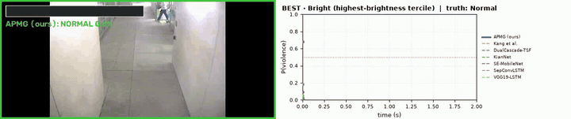 <b>BEST · Bright (highest-brightness tercile)</b> · <code>nofi067.mp4</code> (truth: Normal)</td>
</tr>
<tr>
<td align="center" width="50%">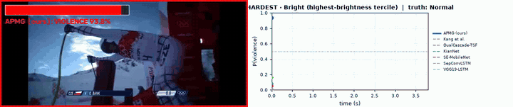 <b>HARDEST · Bright (highest-brightness tercile)</b> · <code>NV_98.mp4</code> (truth: Normal)</td>
<td align="center" width="50%">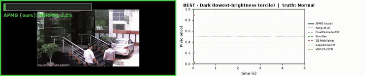 <b>BEST · Dark (lowest-brightness tercile)</b> · <code>Yma07mlW_0.avi</code> (truth: Normal)</td>
</tr>
<tr>
<td align="center" width="50%">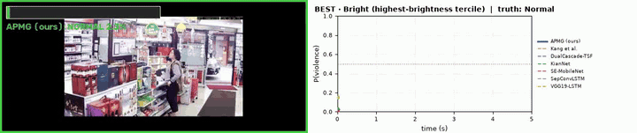 <b>BEST · Bright (highest-brightness tercile)</b> · <code>fGyFpyjd_0.avi</code> (truth: Normal)</td>
<td align="center" width="50%">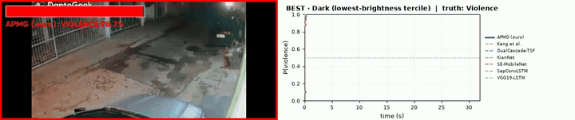 <b>BEST · Dark (lowest-brightness tercile)</b> · <code>F_120_1_0_0_0.mp4</code> (truth: Violence)</td>
</tr>
<tr>
<td align="center" width="50%">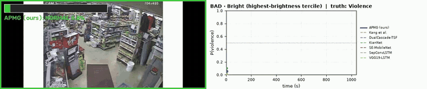 <b>BAD · Bright (highest-brightness tercile)</b> · <code>F_151_0_0_1_0.mp4</code> (truth: Violence)</td>
</tr>
</table>

### Test-time temporal sampling

| Dataset | Case | Clip | Truth | APMG 3-seed ptrue (seeds correct) | APMG (ours) | Kang et al. | DualCascade-TSF | KianNet | SE-MobileNet | SepConvLSTM | VGG19-LSTM |
|:--|:--|:--|:--|--:|--:|--:|--:|--:|--:|--:|--:|
| Surveillance Camera Fight | FRAGILE · Temporal sampling (9 conditions) | [`nofi011.mp4`](condition_cases/surv/temporal_fragile_temporal_sampling__9_conditions_nofi011.mp4) | Normal | 0.51 (CV fold) | **0.49** | 0.54 ✗ | 0.28 | 0.05 | 1.00 ✗ | 0.71 ✗ | 0.54 ✗ |
| RLVS | ROBUST · Temporal sampling (9 conditions) | [`V_868.mp4`](condition_cases/rlvs/temporal_robust_temporal_sampling__9_conditions_V_868.mp4) | Violence | 0.98 (3/3) | **0.98** | 1.00 | 1.00 | 0.98 | 0.57 | 0.99 | 1.00 |
| RWF-2000 | ROBUST · Temporal sampling (9 conditions) | [`q4jlVJRb_0.avi`](condition_cases/rwfreal/temporal_robust_temporal_sampling__9_conditions_q4jlVJRb_0.mp4) | Normal | 0.97 (3/3) | **0.02** | 0.00 | 0.01 | 0.02 | 0.50 | 0.07 | 0.02 |
| RWF-2000 | FRAGILE · Temporal sampling (9 conditions) | [`48J5lk4QcpE_0.avi`](condition_cases/rwfreal/temporal_fragile_temporal_sampling__9_conditions_48J5lk4QcpE_0.mp4) | Violence | 0.43 (2/3) | **0.54** | 0.63 | 0.21 ✗ | 0.98 | 0.63 | 0.66 | 0.78 |
| UBI-Fights | FRAGILE · Temporal sampling (9 conditions) | [`F_153_1_1_0_0.mp4`](condition_cases/ubi/temporal_fragile_temporal_sampling__9_conditions_F_153_1_1_0_0.mp4) | Violence | 0.77 (2/3) | **0.91** | 0.49 ✗ | 0.63 | 0.13 ✗ | 0.00 ✗ | 0.57 | 0.17 ✗ |

GIFs

<table>
<tr>
<td align="center" width="50%">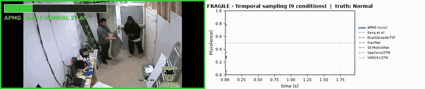 <b>FRAGILE · Temporal sampling (9 conditions)</b> · <code>nofi011.mp4</code> (truth: Normal)</td>
<td align="center" width="50%">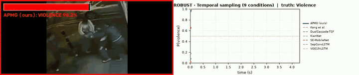 <b>ROBUST · Temporal sampling (9 conditions)</b> · <code>V_868.mp4</code> (truth: Violence)</td>
</tr>
<tr>
<td align="center" width="50%">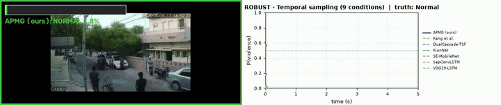 <b>ROBUST · Temporal sampling (9 conditions)</b> · <code>q4jlVJRb_0.avi</code> (truth: Normal)</td>
<td align="center" width="50%">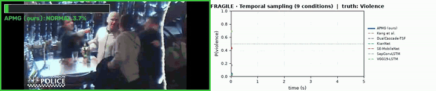 <b>FRAGILE · Temporal sampling (9 conditions)</b> · <code>48J5lk4QcpE_0.avi</code> (truth: Violence)</td>
</tr>
<tr>
<td align="center" width="50%">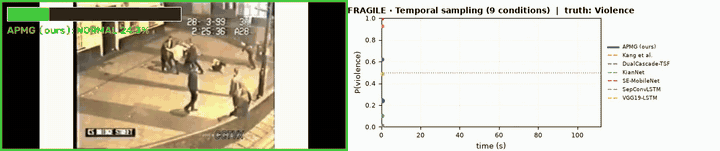 <b>FRAGILE · Temporal sampling (9 conditions)</b> · <code>F_153_1_1_0_0.mp4</code> (truth: Violence)</td>
</tr>
</table>

### APMG vs. the three strongest comparators

| Dataset | Case | Clip | Truth | APMG 3-seed ptrue (seeds correct) | APMG (ours) | Kang et al. | DualCascade-TSF | KianNet | SE-MobileNet | SepConvLSTM | VGG19-LSTM |
|:--|:--|:--|:--|--:|--:|--:|--:|--:|--:|--:|--:|
| Surveillance Camera Fight | APMG WINS · APMG vs Kang / DualCascade / KianNet | [`nofi057.mp4`](condition_cases/surv/compare_apmg_wins_apmg_vs_kang___dualcascade___kiannet_nofi057.mp4) | Normal | 0.85 (CV fold) | **0.15** | 0.80 ✗ | 0.93 ✗ | 0.96 ✗ | 1.00 ✗ | 0.70 ✗ | 0.73 ✗ |
| Surveillance Camera Fight | APMG LOSES · APMG vs Kang / DualCascade / KianNet | [`fi019.mp4`](condition_cases/surv/compare_apmg_loses_apmg_vs_kang___dualcascade___kiannet_fi019.mp4) | Violence | 0.03 (CV fold) | **0.03 ✗** | 0.77 | 0.55 | 0.67 | 1.00 | 0.97 | 0.73 |
| RWF-2000 | APMG WINS · APMG vs Kang / DualCascade / KianNet | [`g6jdqkcdgqk_4.avi`](condition_cases/rwfreal/compare_apmg_wins_apmg_vs_kang___dualcascade___kiannet_g6jdqkcdgqk_4.mp4) | Violence | 0.93 (3/3) | **0.94** | 0.01 ✗ | 0.58 | 0.97 | 0.56 | 0.75 | 0.68 |
| RWF-2000 | APMG LOSES · APMG vs Kang / DualCascade / KianNet | [`2lrARl7utL4_2.avi`](condition_cases/rwfreal/compare_apmg_loses_apmg_vs_kang___dualcascade___kiannet_2lrARl7utL4_2.mp4) | Normal | 0.06 (0/3) | **0.94 ✗** | 0.10 | 0.79 ✗ | 0.03 | 0.56 ✗ | 0.54 ✗ | 0.66 ✗ |

GIFs

<table>
<tr>
<td align="center" width="50%">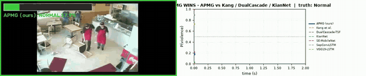 <b>APMG WINS · APMG vs Kang / DualCascade / KianNet</b> · <code>nofi057.mp4</code> (truth: Normal)</td>
<td align="center" width="50%">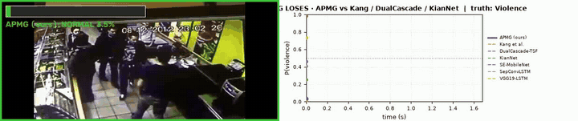 <b>APMG LOSES · APMG vs Kang / DualCascade / KianNet</b> · <code>fi019.mp4</code> (truth: Violence)</td>
</tr>
<tr>
<td align="center" width="50%">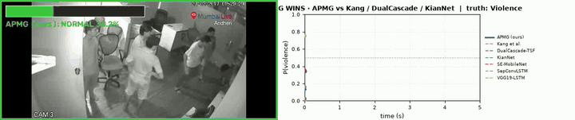 <b>APMG WINS · APMG vs Kang / DualCascade / KianNet</b> · <code>g6jdqkcdgqk_4.avi</code> (truth: Violence)</td>
<td align="center" width="50%">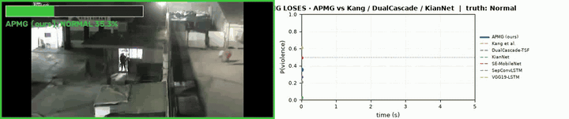 <b>APMG LOSES · APMG vs Kang / DualCascade / KianNet</b> · <code>2lrARl7utL4_2.avi</code> (truth: Normal)</td>
</tr>
</table>

---

## 4. Real-time demo (webcam / RTSP / video file)

The real-time demo runs APMG on a live stream and raises a smoothed alarm.

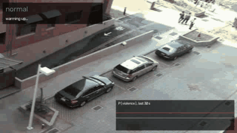

- Alarm with hysteresis: ON when at least 3 of the last 5 predictions (every 0.5 s) are ≥ 0.6; OFF when all of the last 5 are < 0.4.
- Overlay: state, P(violence), latency and a 30 s probability trace; red border while the alarm is on.
- Logs: every prediction (`windows.csv`) and every alarm with start / end / peak (`events.csv`).

**Example run** ([`realtime/realtime_apmg_surv.mp4`](realtime/realtime_apmg_surv.mp4), logs in `realtime/`): a 22 s stream of 11 SURV test clips of cross-validation fold 0 joined back to back (non-violent / 2 fights / non-violent / 2 fights / non-violent), fold-0 weights, RTX 5060 Ti, ≈57 ms per prediction. Both fight segments raised an alarm (5.4–8.7 s → alarm at 6.7 s; 14.8–20.1 s → alarm at 16.1 s), with no false alarm. The clips were ones APMG classifies correctly, so this demonstrates the streaming pipeline, not field accuracy.

**Before real deployment:** the thresholds are uncalibrated defaults. Fine-tune and set them on footage from the target cameras (target false alarms per camera per day, then read recall), keep a human in the loop to confirm alarms, and follow local privacy law (e.g. PDPA) for retention and access.

---

## 5. Motion-gate visualization (all 16 frames)

What the motion gate does over a whole test clip, for the *best violent* clip of each dataset (Batch 1). Each video steps through the 16 frames the models read (4 fps) and shows four panels:

**frame | frame difference ‖xt − xt−1‖ | gate of the original MSM (Kang et al.) | gate of APMG (ours)**

Both gates come from the trained networks (seed 42; SURV: the fold model that tested the clip). Each gate is colour-scaled to its own range over the clip (magma: dark = low, bright = high). *r* = correlation between the gate and the frame difference in that frame (both averaged to a 7×7 grid).

| Dataset | Clip | APMG: frames with r < 0 (median r) | Original MSM: frames with r < 0 (median r) | Video |
|:--|:--|:--:|:--:|:--|
| Hockey Fight | `fi88_xvid.avi` | 16/16 (−0.98) | 0/16 (+0.89) | [MP4](gate_visualization/hockey_gate.mp4) |
| Surveillance Camera Fight | `fi040.mp4` | 16/16 (−0.92) | 16/16 (−0.57) | [MP4](gate_visualization/surv_gate.mp4) |
| RLVS | `V_293.mp4` | 0/16 (+0.74) | 0/16 (+0.79) | [MP4](gate_visualization/rlvs_gate.mp4) |
| RWF-2000 | `Violence/7gLKFV5voOg_0.avi` | 16/16 (−0.98) | 11/16 (−0.21) | [MP4](gate_visualization/rwfreal_gate.mp4) |
| UBI-Fights | `F_107_1_2_0_0.mp4` | 16/16 (−0.99) | 16/16 (−0.91) | [MP4](gate_visualization/ubi_gate.mp4) |

<table>
<tr><td align="center"> Hockey Fight · <code>fi88_xvid.avi</code></td></tr>
<tr><td align="center"> Surveillance Camera Fight · <code>fi040.mp4</code></td></tr>
<tr><td align="center"> RLVS · <code>V_293.mp4</code></td></tr>
<tr><td align="center"> RWF-2000 · <code>Violence/7gLKFV5voOg_0.avi</code></td></tr>
<tr><td align="center"> UBI-Fights · <code>F_107_1_2_0_0.mp4</code></td></tr>
</table>

---

## 6. Usage

- Clips: H.264 `.mp4`, 10 fps, 1238×260 (panel); GIFs are smaller previews of the same clips. They play in any browser or standard player. Gate videos (Section 5): H.264, 4 fps, 896×246.
- `results/showcase_manifest.csv` — every clip: dataset, case, truth, P(violence) of all seven models.

> These are rendered outputs (overlays and plot are part of the pixels) and cannot be fed back into a model. To run inference, obtain the original videos from the datasets below.

---

## Attribution

The underlying footage is derived from public violence-detection benchmarks. Please cite the original datasets if you use these clips:

- **Hockey Fight** — E. Bermejo Nievas, O. Deniz Suarez, G. Bueno García, R. Sukthankar, *"Violence Detection in Video Using Computer Vision Techniques,"* CAIP, 2011.
- **SURV (Surveillance Camera Fight)** — Ş. Aktı, G. A. Tataroğlu, H. K. Ekenel, *"Vision-based Fight Detection from Surveillance Cameras,"* IPTA, 2019.
- **RLVS (Real-Life Violence Situations)** — M. M. Soliman *et al.,* *"Violence Recognition from Videos Using Deep Learning Techniques,"* ICICIS, 2019.
- **RWF-2000** — M. Cheng, K. Cai, M. Li, *"RWF-2000: An Open Large Scale Video Database for Violence Detection,"* ICPR, 2020.
- **UBI-Fights** — B. Degardin, H. Proença, *"Iterative Weak/Self-Supervised Classification Framework for Abnormal Events Detection,"* Pattern Recognition Letters, 2021.

## Citation

> To be added after publication.

## License

> _TODO: add a license. Redistribution of the sample footage may be subject to the terms of the original datasets._
